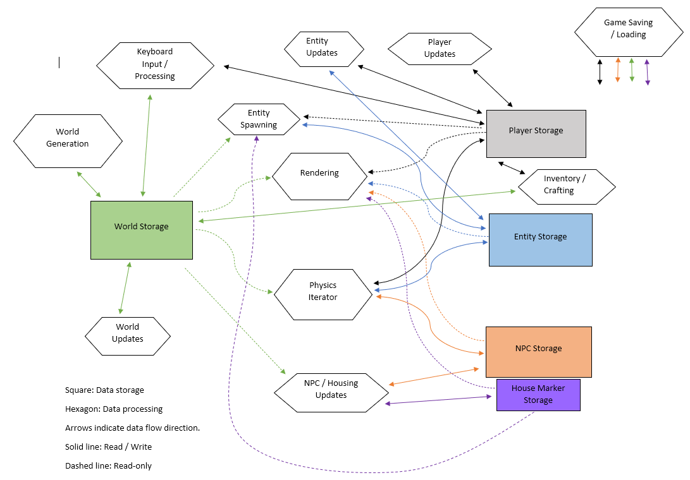

# Architecture

This document describes the high-level architecture of Terrario.

## Data Flow

The main game loop consists of working on data clumped in five main groups:

- World storage: A 128x96 tile window of the infinite world (4x3 chunks of 32x32 tiles), its NPCs and house markers. The window slides over the world as the player moves. Chunks the player modified are saved when they leave the window; untouched chunks are simply regenerated from the world seed. Chest contents are stored one file per chest; only the chest currently being interacted with is kept in RAM.
- Player storage: The player's current state, including their inventory.
- Entity storage: The current world entities.
- NPC storage: The world's NPCs.
- House Marker Storage: The world's house markers, both empty and occupied.

## Coordinates

The game logic works in *window-local* coordinates: tile (0, 0) is the top-left tile of the window in RAM, and `getTile()`/`setTile()` only see the window. `stream.originX`/`stream.originY` give the *global* tile coordinates of that corner. When the window moves, `stream.c` shifts every stored window-local position (player, entities, NPCs, markers, particles, the variant buffer) so they keep pointing at the same place.

Things that must survive the window moving away are stored in global coordinates: the spawn point (global pixels), chest files, `npc.dat`, `player.dat`.

`setTile()` marks the chunk as modified so it gets saved. `setTileNatural()` is for changes the world makes on its own (falling sand, flowing water, spreading grass): those don't force a save, because they will happen again if the chunk is regenerated.

## Code Map

Important files. Additionally, the header files have descriptions of each exposed function.

### `entity`

Encompasses enemy behaviours, the physics iterator, and entity updates/spawning. Note that the iterator must be manually called for each physics property structure, done throughout the various update procedures.

### `worldgen`

The infinite world generator, modelled on Minecraft 1.18+. It is a pure function of (seed, chunk): fixed-point only (the SH3/SH4 target has no usable FPU) and with no gint dependency, so it can run on a PC. Steps: multi-noise climate and biome selection, spline-shaped terrain with rivers and peaks, per-biome surface rules, noise caves (cheese/spaghetti/noodle) plus worm carvers, lakes, structures on a spread grid (mineshafts, buried cabins, surface houses), ore veins, decoration and vegetation. Features crossing chunk borders are replayed from every chunk they touch.

Preview it on a PC with `util/wgpreview.c` (build instructions at the top of the file).

### `stream`

The sliding chunk window: loading, generating, saving and shifting chunks.

### `npc`

Everything to do with both NPCs and house markers. NPCs outside the window are frozen until the player comes back.

### `render`

Takes care of both rendering the game and updating the scrolling window that holds tile variants. Also manages the particle explosion effect.

### `save`

Encompasses saving and loading the game from the calculator's storage memory. File names are kept within the 8.3 limit of the older CASIOWIN filesystem (`C` + base-32 chunk coordinates, `K` + base-32 chest coordinates). The folder path is defined once, in `save.h`.

### `update`

Manages keyboard input processing, updating the player's state, and updating non-static world tiles in the player's vicinity.

### `world`

Various functions for manipulating the world tiles.
